<!--
  README de perfil. Todo lo que está fuera de los marcadores profilescape es tuyo para editar.
  Lo que hay entre los marcadores lo reescribe cada día .github/workflows/profilescape.yml.
-->

<!-- profilescape:start -->

<picture>
  <source media="(prefers-color-scheme: dark)" srcset="https://raw.githubusercontent.com/GabrielNunezPe/GabrielNunezPe/profilescape-output/hero-dark.svg" />
  
</picture>

<a href="https://github.com/GabrielNunezPe">
<picture>
  <source media="(prefers-color-scheme: dark)" srcset="https://raw.githubusercontent.com/GabrielNunezPe/GabrielNunezPe/profilescape-output/social-github-dark.svg" />
  
</picture>
</a>
<a href="https://www.linkedin.com/in/gabrielnunezperez">
<picture>
  <source media="(prefers-color-scheme: dark)" srcset="https://raw.githubusercontent.com/GabrielNunezPe/GabrielNunezPe/profilescape-output/social-linkedin-dark.svg" />
  
</picture>
</a>
<a href="mailto:2eganunez@gmail.com">
<picture>
  <source media="(prefers-color-scheme: dark)" srcset="https://raw.githubusercontent.com/GabrielNunezPe/GabrielNunezPe/profilescape-output/social-email-dark.svg" />
  
</picture>
</a>
<a href="https://gabrielnunezpe.github.io">
<picture>
  <source media="(prefers-color-scheme: dark)" srcset="https://raw.githubusercontent.com/GabrielNunezPe/GabrielNunezPe/profilescape-output/social-portfolio-dark.svg" />
  
</picture>
</a>

<picture>
  <source media="(prefers-color-scheme: dark)" srcset="https://raw.githubusercontent.com/GabrielNunezPe/GabrielNunezPe/profilescape-output/stack-dark.svg" />
  
</picture>

<picture>
  <source media="(prefers-color-scheme: dark)" srcset="https://raw.githubusercontent.com/GabrielNunezPe/GabrielNunezPe/profilescape-output/stats-dark.svg" />
  
</picture>

<picture>
  <source media="(prefers-color-scheme: dark)" srcset="https://raw.githubusercontent.com/GabrielNunezPe/GabrielNunezPe/profilescape-output/3d-dark.svg" />
  
</picture>

<picture>
  <source media="(prefers-color-scheme: dark)" srcset="https://raw.githubusercontent.com/GabrielNunezPe/GabrielNunezPe/profilescape-output/languages-dark.svg" />
  
</picture>

<table>
  <tr>
    <td width="50%">
<a href="https://github.com/GabrielNunezPe/GabrielNunezPe.github.io">
<picture>
  <source media="(prefers-color-scheme: dark)" srcset="https://raw.githubusercontent.com/GabrielNunezPe/GabrielNunezPe/profilescape-output/repo-gabrielnunezpe-gabrielnunezpe-github-io-dark.svg" />
  
</picture>
</a>
    </td>
    <td width="50%">
<a href="https://github.com/GabrielNunezPe/ArtHub">
<picture>
  <source media="(prefers-color-scheme: dark)" srcset="https://raw.githubusercontent.com/GabrielNunezPe/GabrielNunezPe/profilescape-output/repo-gabrielnunezpe-arthub-dark.svg" />
  
</picture>
</a>
    </td>
  </tr>
</table>

<!-- profilescape:end -->

---

## 🧑‍💻 Sobre mí

🌐 **Portfolio:** [gabrielnunezpe.github.io](https://gabrielnunezpe.github.io)

¡Hola! Soy **Gabriel**, desarrollador FullStack. Me gusta construir interfaces rápidas, accesibles y fáciles de mantener, y creo que el código limpio es la mejor documentación.

- 🔭 Trabajando en **[ArtHub](https://github.com/GabrielNunezPe/ArtHub)**, una red social para compartir arte (React + TypeScript + Appwrite)
- 🌱 Aprendiendo **testing y arquitectura FullStack**
- 💬 Pregúntame sobre **Vue.js, React y JavaScript moderno**
- 📚 Libro de cabecera: **Clean Code**
- 🎮 Fuera del teclado: **videojuegos retro, series y café**

 

---

  

